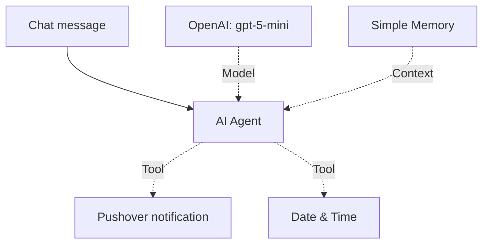

# n8n AI Chatbot with Pushover Notifications

An n8n workflow that combines an OpenAI chat model, conversation memory, and tools for date/time operations and sending Pushover notifications.

## How it works

A chat message starts the AI Agent. The agent uses the connected model and memory to respond and can call its tools when needed.

Pushover is available as an agent tool; a notification is not sent for every chat message. Its message text is supplied by the agent through n8n's `$fromAI` expression.

## Requirements

- An n8n instance supporting the node versions in the export.
- An OpenAI API key with access to the selected model and available API credit.
- A Pushover account, application API token, and user key.
- A device configured to receive Pushover notifications.

## Setup

1. Download [the workflow JSON](workflows/ai-chatbot-pushover.json).
2. Create a workflow in n8n and use **Import from File** to load it.
3. Open **OpenAI Chat Model** and select or create your OpenAI credential. The exported model is `gpt-5-mini`; change it if your account requires another model.
4. Open **Push a message in Pushover** and select or create a Pushover credential using your application API token.
5. Replace `YOUR_PUSHOVER_USER_KEY` in that node with your Pushover user key.
6. Review **Date & Time** and configure the operation and timezone for your intended use. The export leaves this node's options at their defaults.
7. Save the workflow and open its test chat.

The exported workflow is inactive. Test it and configure chat access before activating or publishing it.

## Try it

- Send: “My name is Abed.” Then, in the same chat session, ask: “What is my name?”
- Send: “Send a Pushover notification saying: My n8n chatbot is working.”

Check the execution in n8n to see which tools the agent called, and confirm the notification arrives on your device. Sending a message does not create a scheduled reminder; this workflow has no scheduling trigger.

## Repository contents

| File | Purpose |
| --- | --- |
| `workflows/ai-chatbot-pushover.json` | Importable workflow with six nodes |
| `README.md` | Workflow overview, setup, and manual checks |

## Credentials and privacy

The shared export removes credential references, the original Pushover user key, webhook ID, and instance-specific metadata. Configure your own credentials after importing. Keep API tokens and user keys out of future public exports.

Simple Memory supplies conversation context; this workflow does not configure a persistent database for chat history.

## Validation

The JSON parses successfully and all connection endpoints refer to existing nodes. Live execution has not been tested from this repository; it requires your configured n8n credentials.

Built by [Abed Alrahman Fataftah](https://github.com/abed-fataftah).
